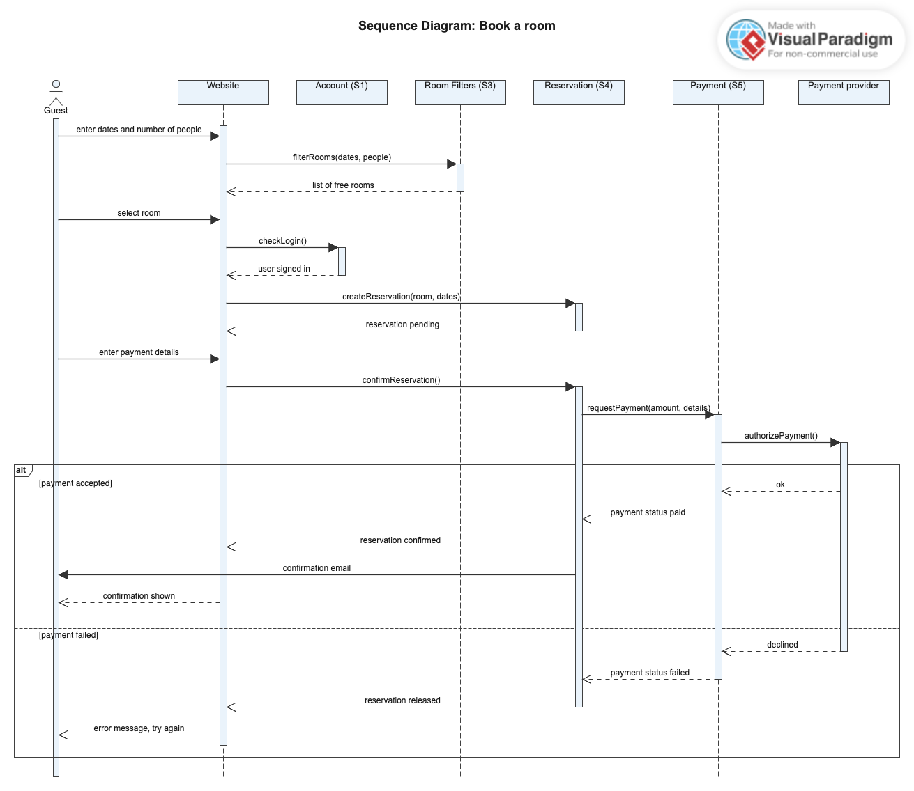
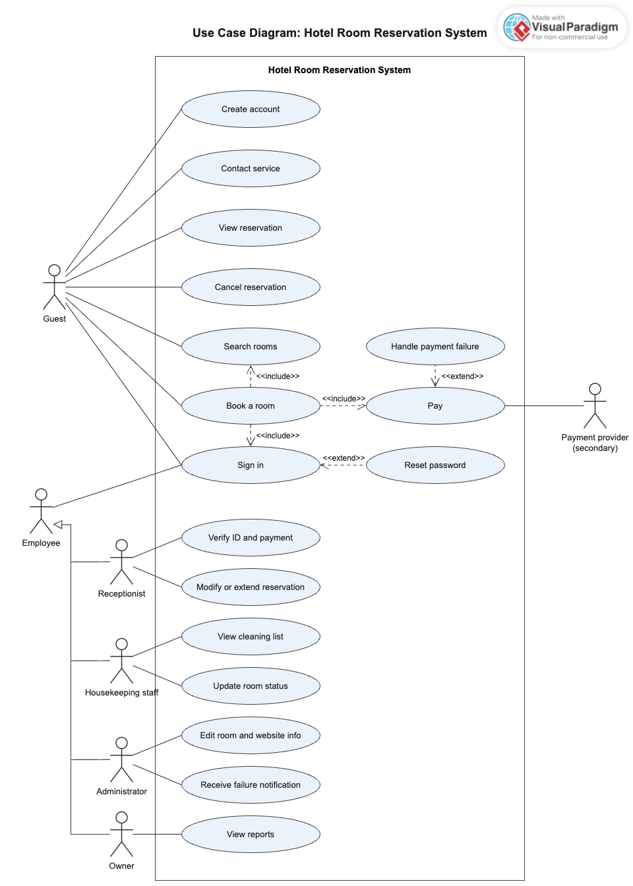

# Assignment 1: Hotel Room Reservation – Requirements

**Team: Exchange student**

| Student number | Name |
|---|---|
| 2601764 | Seungheon Sa |
| 2601783 | Marin Wasier |
| 2601760 | Patrick Hein |

---

## 1. Stakeholders

**Primary stakeholders** (use the system directly)

| Stakeholder | Needs |
|---|---|
| Owner | Profitable business, the application works, security, accessibility, reports on occupancy and revenue |
| Receptionist | Reservations, payment, identification of the guest |
| Housekeeping staff | Room status (occupied or empty), which room has to be cleaned |
| Administrator | Edit room details and website information, gets notified about system failures |
| Guest (user) | Make a reservation, room details, security of the application, contact to the service |

**Secondary stakeholders** (support the system from outside)

| Stakeholder | Role |
|---|---|
| Payment provider | Processes the payments and returns the payment status |

---

## 2. Requirements

| Requirement | Type |
|---|---|
| The application shows every room with its details | Functional |
| A guest can reserve a room and then pay for it | Functional |
| There is a sign-in / sign-up function | Functional |
| Housekeeping staff know which room to clean | Functional |
| The receptionist can check that the identification and the payment are correct | Functional |
| There are different pages for different admin levels | Functional |
| If the dates of a reservation are not valid, the booking is blocked | Functional |
| The receptionist can modify and extend reservations. Admins can edit room details and the website information | Functional & Maintainability |
| The website is quick: a room search shows its result in max. 2 seconds, and a booking is visible to other users within 5 seconds | Performance |
| The website is reliable (available 99 % of the time). In case of a failure, the service contact is shown and a monitoring service notifies the staff | Reliability |
| User IDs, passwords and payment details are secured | Security |
| Normal users can't modify or extend a reservation, they can only cancel their own | Security |
| The application uses an external payment service | Compatibility |

**Additional requirements**

- **Functional:** guests filter rooms by dates and number of people; users reset a forgotten password; guests view and cancel their own reservations; confirmation email after a booking; owner sees occupancy and revenue reports; optional reminder email before arrival
- **Performance:** 100 users at the same time without slowdown; reports within 5 seconds
- **Usability:** booking in max. 5 steps; works on phone, tablet and desktop; accessible, with readable contrast and keyboard use; clear error messages, e.g. "password incorrect"
- **Reliability:** no double bookings; regular backups
- **Security:** role-based access for each employee level; input validation and session timeout
- **Maintainability:** modular subsystems; automated tests in the CI pipeline; Git version control
- **Compatibility:** common browsers; email service; monitoring service
- **Constraints:** GDPR; security rules of the payment provider; limited time and a team of three

---

## 3. Subsystems

| | Subsystem | Purpose |
|---|---|---|
| S1 | Account and authentication | Manage accounts, sign-in, sign-up, roles and security |
| S2 | Room catalogue | Show every room with its details |
| S3 | Room filters | Find the rooms that fit the request of the guest |
| S4 | Reservation management | Handle all reservations |
| S5 | Payment | Process the payments |
| S6 | Administration (back office) | Admin-only pages for the employees |
| S7 | Housekeeping service | Tell the cleaners which room to clean |
| S8 | Monitoring and notification | Watch the system automatically |

### S1: Account and authentication
- **Purpose:** manage accounts, sign-in, sign-up, roles and security
- **Input:** email, password, name, sign-in credentials, password reset request
- **Output:** account created, error (e.g. "password incorrect"), session with roles
- **Functional:** sign-in, sign-up, password reset
- **Non-functional:** hashed passwords, input validation, session timeout, clear error messages

### S2: Room catalogue
- **Purpose:** show every room with its details
- **Input:** none from the user
- **Output:** rooms and their details
- **Functional:** show photos, price and capacity of each room
- **Non-functional:** loads in max. 2 seconds, usable on phone and desktop, accessible, common browsers

### S3: Room filters
- **Purpose:** find the rooms that fit the request of the guest
- **Input:** reservation details (number of people, dates, …)
- **Output:** list of rooms that meet these conditions
- **Functional:** filters the rooms by the conditions, only free rooms are shown
- **Non-functional:** result in max. 2 seconds, room status is up to date for all users

### S4: Reservation management
- **Purpose:** handle all reservations
- **Input:** reservation details (room, dates, guest), request to cancel, modify or extend, ID check
- **Output:** processed reservation, confirmation email, error if the dates are not valid
- **Functional:** guests create, view and cancel reservations; the receptionist modifies and extends them and checks ID and payment; invalid dates are blocked; a confirmation is sent
- **Non-functional:** no double bookings, backups, only the receptionist can modify, 100 users at the same time, up-to-date status, booking in max. 5 steps, email service

### S5: Payment
- **Purpose:** process the payments
- **Input:** card / PayPal / other payment details, amount
- **Output:** payment status
- **Functional:** process the payment, check the authentication of the payment, handle a failed payment
- **Non-functional:** card data is not stored, rules of the payment provider, interface to the provider, payment status and reservation stay consistent

### S6: Administration (back office)
- **Purpose:** admin-only pages for the employees
- **Input:** edits to room details, prices, website information and service contact; report requests
- **Output:** updated data, reports
- **Functional:** show the admin pages by access level, verify and edit details on the website, show reports, show the service contact
- **Non-functional:** role-based access, changes without code, reports in max. 5 seconds

### S7: Housekeeping service
- **Purpose:** tell the cleaners which room to clean
- **Input:** room status update after cleaning
- **Output:** cleaning lists, updated room status
- **Functional:** list the rooms to clean, update the room status after cleaning
- **Non-functional:** new status is visible to other users within 5 seconds

### S8: Monitoring and notification
- **Purpose:** watch the system automatically
- **Input:** system health data (automatic)
- **Output:** notifications for the admins or engineers
- **Functional:** automatic monitoring, system failure detection
- **Non-functional:** availability of 99 %, service contact is shown when a failure happens, interface to the monitoring service

### Interaction of the subsystems
- **S1** checks who the user is and applies the role before S4, S6 and S7 allow actions
- **S3** takes the rooms from S2 and the availability from S4
- **S4** asks S5 for the payment status and confirms the reservation, or releases it if the payment fails
- **S5** sends the payment request to the external payment provider
- **S6** maintains the room data that S2 shows and builds the reports from S4 and S5 data
- **S7** sets the room status that S3 uses for the availability
- **S8** watches all subsystems and notifies the staff (admins / engineers)

---

## 4. Prioritization of the needs

**Approach:** first we collect the needs of the stakeholders and sort them into *normal*, *expected* and *exciting*. We rate how important each need is to the customer (scale from 1 to 10). Then we translate each need into a measurable technical requirement and rank the needs by importance.

**Customer voice table and technical requirements**

| # | Customer need | Stakeholder | Type | Importance (1–10) | Measurable technical requirement | Priority |
|---|---|---|---|---|---|---|
| 1 | Reserve a room and pay online | Guest | Normal | 10 | From search to confirmation in max. 5 steps | Must |
| 2 | No double bookings | Guest, owner | Expected | 10 | Zero conflicting reservations, availability checked at booking time | Must |
| 3 | Personal and payment data are safe | Guest, owner | Expected | 9 | Hashed passwords, encrypted transfer, no stored card data | Must |
| 4 | See quickly which rooms are free | Guest, receptionist | Normal | 9 | Search result in max. 2 s, status change visible within 5 s | Must |
| 5 | Website works reliably | Owner | Expected | 8 | Availability 99 %, automatic notification on failure | Should |
| 6 | Know which room to clean | Housekeeping staff | Normal | 7 | Cleaning list generated automatically from room status | Should |
| 7 | Check identification and payment correctly | Receptionist | Normal | 7 | ID check and payment status shown for each reservation | Should |
| 8 | See occupancy and revenue | Owner | Normal | 6 | Report generated within 5 s | Should |
| 9 | Edit room and website information | Admin | Normal | 6 | Admin pages per access level, edits without code changes | Should |
| 10 | Easy use on phone | Guest | Expected | 5 | Layout adapts to phones and other devices | Nice to have |
| 11 | Clear error messages | Guest | Expected | 5 | Specific message for each error case | Nice to have |
| 12 | Reminder before arrival | Guest | Exciting | 3 | Reminder email one day before arrival | Nice to have |

High-priority needs (1 to 4) are built first. Medium-priority needs (5 to 9) come next, and low-priority needs (10 to 12) are built last or are optional.

---

## 5. Diagrams

**Sequence diagram**

**Use case diagram**

