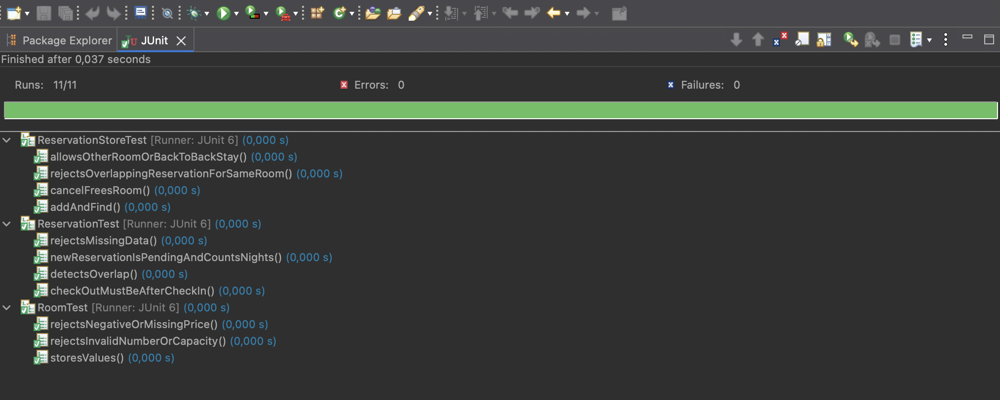
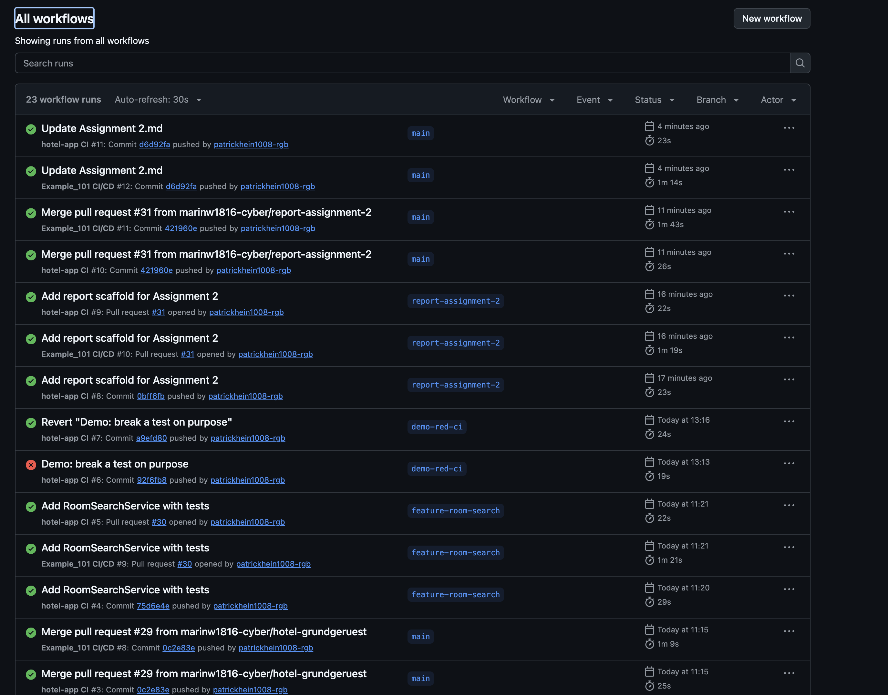
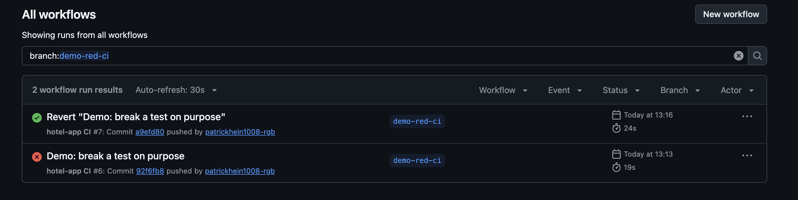
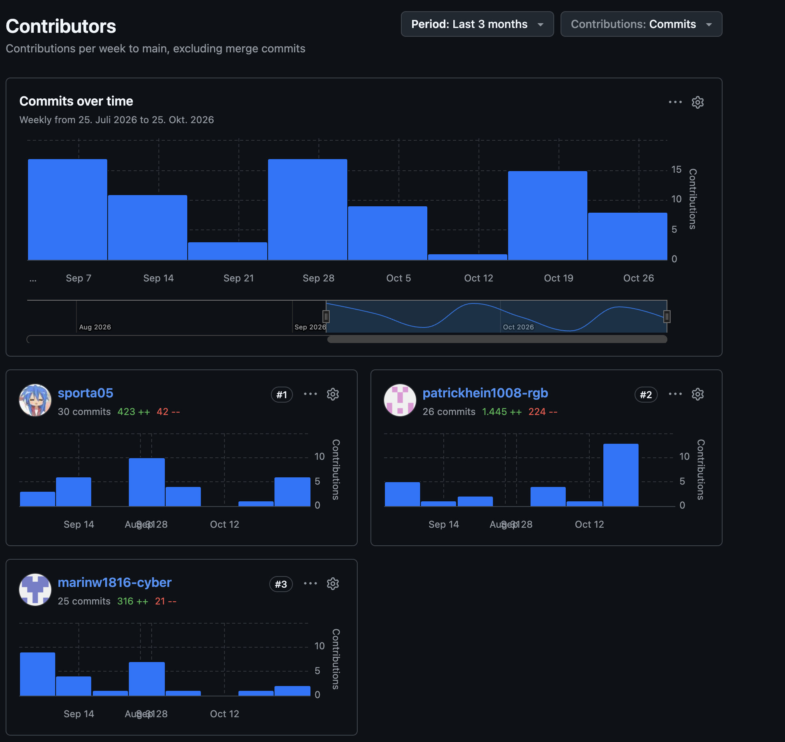
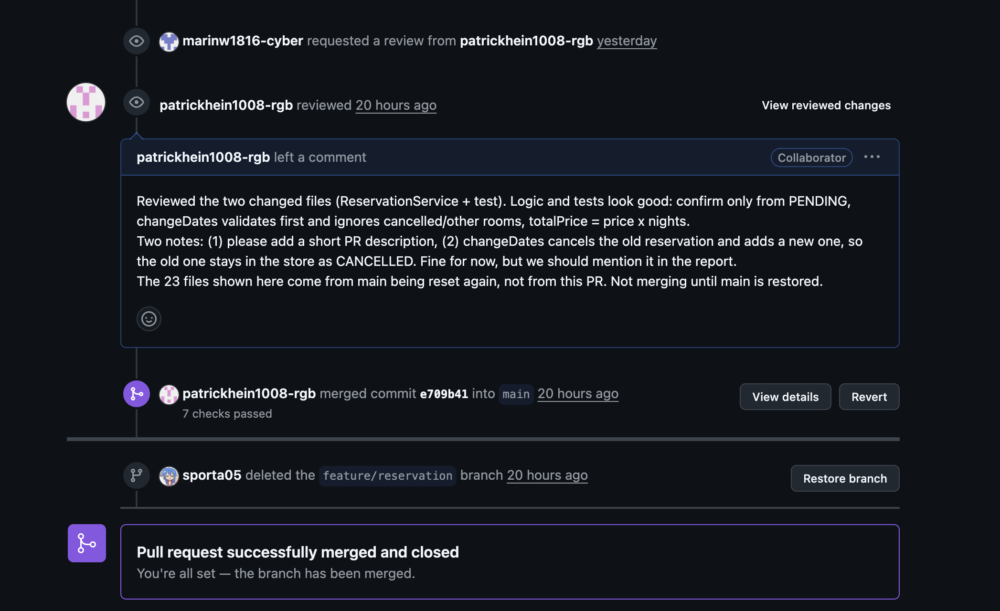

Team: Exchange student
2601764 Seungheon, Sa
2601783 Wasier, Marin
2601760 Hein, Patrick

# Assignment 2 (CI/CD): Report

## 1. Team and choice of language
- Language: Java 21 with Maven and JUnit 6
- Reason: the CI pipeline of the course already runs Maven, JDK 21 and Eclipse are set up for all three of us
- Tools: Eclipse as IDE, GitHub for pull requests and Actions

## 2. Who does what
| Person | Role | Feature | Package |
|---|---|---|---|
| Patrick | Repo, CI/CD, integration | Room search, BookingService | hotel.search, hotel.booking |
| Marin | Reservation | Confirm, change dates, total price | hotel.reservation |
| Seungheon | User accounts | Registration, login, roles, hashed password | hotel.user |

## 3. Repository structure and branch rules
- Repo: marinw1816-cyber/Project-hotel-room
- Folder `hotel-app` (Maven project). `Example_101` and the workflow of the course stay untouched.
- Own workflow: `.github/workflows/hotel-app-ci.yml` (runs `mvn -B test` on every push and on pull requests to main)
- Rules: Code changes always go through a branch and a pull request. Small edits to this report file were committed directly to main.
- Review rotation (plan): Patrick reviews Marin, Marin reviews Seungheon, Seungheon reviews Patrick.
- In practice: Patrick reviewed Marin's PR #33 before it was merged. PR #30 (room search), PR #35 (BookingService) and PR #38 (user accounts) were merged without a review, although a review was requested on each of them. PR #38 was merged about one minute after it was opened.
- One code commit ("Add user directory", `5687faf`) went directly to main on 25 October, although code changes should always go through a branch and a pull request.

## 4. Progress in screenshots
Eclipse: all 11 tests of the skeleton are green (JUnit 6).

GitHub Actions: runs of the workflows on our branches.

Red and green run on the branch `demo-red-ci`: run #6 failed because of a broken test, run #7 after the revert was green.

Commits per author on main (GitHub Insights, Contributors, merge commits excluded, status 26 October 2026). All three of us have commits on main. The numbers count commits, not the amount of work.

Pull request #33 (Marin's reservation feature) with my review comment and the merge. GitHub listed 16 commits on this PR because main had been reset when it was opened. The PR itself adds one commit (`bf180fa`) with two files.

## 5. What we learned and what went wrong
- GitHub main was reset to an older commit and lost the merge of PR #25. We restored it with a pull request (PR #28) instead of a force push.
- Our local clone has GitLab as origin, so a plain `git pull` fetched the wrong state. We now use `git pull github main`.
- main was reset a second time on 21 October by a force push. PR #30 brought most of the state back, PR #34 restored the report and the images. Again we did not force push ourselves.
- PR #30 was merged without the requested review. A review request does not block a merge, only a branch rule with required reviews would. main is not protected on GitHub.
- Several branches were deleted on 21 October, among them `demo-red-ci`. The red and green runs (#6 and #7) are still in the Actions history.
- On 25 October one code commit went directly to main (`5687faf`), and PR #35 and PR #38 were merged without a review. PR #38 was merged about one minute after it was opened, although a review had been requested. A review request does not stop a merge, so our review rotation only worked once (Patrick reviewed PR #33).
- Result: all 40 tests are green locally (`mvn -B test`) and in GitHub Actions on main (run #42, commit `48baa67`).
- Lesson: rules that are only agreed and not enforced did not hold. A branch rule on main with a required review would have blocked these merges.

---

## Own part: Patrick

Role: repository, CI/CD and integration.

- Built the project `hotel-app` (Maven, Java 21) with `Room`, `ReservationStatus`, `Reservation` and `ReservationStore` and 11 unit tests (PR #29). All tests are green in Eclipse (JUnit 6), see section 4.
- Pipeline: `.github/workflows/hotel-app-ci.yml` runs `mvn -B test` with Java 21 on every push and on every pull request to main. The workflow of the course stays unchanged.
- Red and green run: I broke a test on purpose on the branch `demo-red-ci`. Run #6 failed, after the revert run #7 was green. This shows that the pipeline reports a broken test before the code reaches main.
- Feature room search: `RoomSearchService` returns the rooms with enough capacity that are free in the period. Cancelled reservations do not block a room. 5 new tests, 16 in total, all green (PR #30).
  PR #30 was merged without the requested review, so there is no review screenshot for it. My review of Marin's PR #33 is shown in section 4.
- Code changes go through an own branch and a pull request. The PRs #28 and #34 (restore of main after the resets, section 5), #29 (skeleton), #31 and #32 (report file and images) were all merged without review, and small edits to this report were committed directly to main. Code changes get a review, but PR #35 (BookingService) was merged without the requested review (section 3).
- I used Claude Code for writing code. It never commits, pushes or merges, I run the tests and do the Git steps myself.
- BookingService (`hotel.booking`): `book` searches the free rooms with `RoomSearchService`, takes the cheapest one that is big enough, creates a PENDING reservation and saves it in the store. `confirm` and `totalPrice` are passed on to `ReservationService`, so no rule exists twice. 7 new tests, 40 in the whole project, all green (PR #35, merged without the requested review, see section 3).
- After the merge I added a review on PR #38 (user accounts) with two small findings: `PasswordHasher.matches()` throws an exception on invalid Base64 instead of returning false, and user names are case sensitive.

## Own part: Marin

Role: reservation feature (package `hotel.reservation`).

- Built `ReservationService` on top of Patrick's model (`Reservation`, `ReservationStatus`, `ReservationStore`). The store is passed through the constructor, and a missing store is rejected immediately with an `IllegalArgumentException`.
- `confirm()`: changes a reservation from PENDING to CONFIRMED. Any other status (CONFIRMED or CANCELLED) throws an `IllegalStateException`.
- `changeDates()`: checks that the new dates do not overlap another active reservation of the same room. The reservation itself, cancelled reservations and other rooms are ignored. The new dates are validated first, so invalid dates or a conflict leave the old reservation unchanged. Because the dates in `Reservation` are final, the old reservation is cancelled and a new one with the new dates and the same status is added and returned.
- `totalPrice()`: number of nights × price per night, as `BigDecimal`.
- 7 unit tests in `ReservationServiceTest` (confirm, confirm rejected for non-pending, change accepted and status kept, overlap rejected, cancelled and other rooms ignored, invalid dates rejected without cancelling, total price).
- Workflow: own branch `feature/reservation` and pull request #33 (one commit, `bf180fa`, two files). The pipeline `hotel-app CI` was green on the push (run #19) and on the pull request (run #20). Patrick reviewed the PR and merged it after main was restored (section 4).
- Review feedback: Patrick asked for a short PR description, which I added. He also pointed out that after a date change the old reservation stays in the store as CANCELLED. We keep it like this for now. A later version could update the dates in place instead.

## Own part: Seungheon
TODO
