Team: Exchange student
2601764 Seungheon, Sa
2601783 Wasier, Marin
2601760 Hein, Patrick

# Assignment 3 (Docker): Report

Status: done. Sections 1 to 4 describe what we agreed to do. Section 5 and the own parts show what happened.

## 1. Application and image
- Application: `hotel-app` (Java 21, Maven) from Assignment 2. New: a small console program `hotel.app.Main` that shows the existing features (room search, booking, reservation, user accounts). The app had no entry point before, so no image could run it.
- Dockerfile: multi-stage build as in Example 8-4 (Maven image builds the JAR, Java 21 JRE image runs it). `src` and `pom.xml` are copied into the runtime image, so everybody can pull the image and take the source code out of it (`docker cp`) to develop further.
- Docker Hub repository: `patrickhein1008/hotel-app` (tags `v1`, `v2`, `v3`, `latest`)
- Platform: GitHub, same repository as Assignment 2 (`marinw1816-cyber/Project-hotel-room`)

## 2. Who does what
| Step | Person | Task | Branch | Reviewer (merges) | Image tag |
|---|---|---|---|---|---|
| 0 | Marin | Branch rule on main (review required, no force push), Docker Hub access for the team | none | none | none |
| 0 | all | Docker installed, `docker run hello-world`, Docker Hub account | none | none | none |
| 1 | Patrick | `Main`, `mainClass` in `pom.xml`, Dockerfile, `.dockerignore`, build, run, first push | `feature-docker` | Seungheon | `v1` |
| 2 | Marin | Pull `v1`, run it, take the source out of the image, add the reservation demo, build, push | `feature-docker-reservation` | Patrick | `v2` |
| 3 | Seungheon | Pull `v2`, run it, add the user demo, build, push | `feature-docker-user` | Marin | `v3` |
| 4 | Patrick | Pull `v3`, check that all three parts run, tag `latest`, collect screenshots, write the report | `report-docker` | Marin | `latest` |

Plan versus reality: PR #43 (step 1) was merged by Marin, not by Seungheon as planned. PR #44 (step 2) was merged by Patrick and PR #50 (step 3) by Marin, as planned.

Order of the chain: each person starts only after the previous pull request is merged. The image is always built from the merged `main`, so the image and `main` show the same code.

## 3. Tasks in detail

### Patrick: Dockerfile and first image
1. Branch `feature-docker` from current `main`.
2. Add `hotel/app/Main.java` in `hotel-app`: console demo with a room list, a search for free rooms and one booking (uses `hotel.search` and `hotel.booking`). It prints the result and exits.
3. Set `mainClass` in the `maven-jar-plugin` of `hotel-app/pom.xml`, so `java -jar` starts the app.
4. Add `Dockerfile` and `.dockerignore` in `hotel-app`.
5. Build and run locally: `docker build -t <user>/<image>:v1 .` and `docker run --rm <user>/<image>:v1`.
6. Pull request with description. Pipeline `hotel-app CI` must be green. Seungheon reviews and merges.
7. After the merge: `git pull github main`, build, `docker push <user>/<image>:v1`.

### Marin: pull, change, push (reservation)
1. Pull `v1` from Docker Hub and run it.
2. Take the source out of the pulled image (`docker create` and `docker cp`, or a shell in the container) and show that it is the same code as on `main`.
3. Branch `feature-docker-reservation` from current `main`. Add a `ReservationDemo` in `hotel.reservation`: create a reservation, confirm it, change the dates, print the total price (uses `ReservationService`). `Main` gets one line that calls it.
4. Add or adjust a test if the change needs one. Pull request, Patrick reviews and merges.
5. After the merge: `git pull github main`, build, run, `docker push <user>/<image>:v2`.

### Seungheon: pull, change, push (user accounts)
1. Pull `v2` from Docker Hub and run it.
2. Branch `feature-docker-user` from current `main`. Add a `UserDemo` in `hotel.user`: register a user, log in with a right and a wrong password, print the role (uses `UserService`). `Main` gets one line that calls it.
3. Add or adjust a test if the change needs one. Pull request, Marin reviews and merges.
4. After the merge: `git pull github main`, build, run, `docker push <user>/<image>:v3`.

### Patrick: check and report (step 4)
- Pull `v3`, run it, check that search, booking, reservation and user demo all appear in the output.
- Tag `latest`, write this report, collect the screenshots listed in section 5.

## 4. Rules
- Code changes only through a branch and a pull request, never directly on main, never `--force`.
- The author does not merge his own pull request. The reviewer merges after the review.
- Every change to `Main` is one line per person, to avoid merge conflicts. The demo code lives in the own package.
- Tokens and passwords never go into the repository, the report or a chat.
- If a step is not done by the requested date, Patrick does it and the report says so. Requested date for step 3: 31.10.2026 (evening, from Patrick's message of 28.10.2026). Step 3 was merged on 02.11.2026 (PR #50), so the fallback was not needed.

## 5. Evidence (screenshots, with caption)
- Patrick: Dockerfile in the pull request, `docker build` and `docker run` output, Docker Hub tags page, final `docker pull` of `v3`.
- Marin: `docker pull` of `v1`, source files taken out of the image, pull request with review, `docker push` of `v2`.
- Seungheon: `docker pull` of `v2`, pull request with review, `docker push` of `v3`.

Screenshots of Patrick (Marin's screenshots are in his own part):

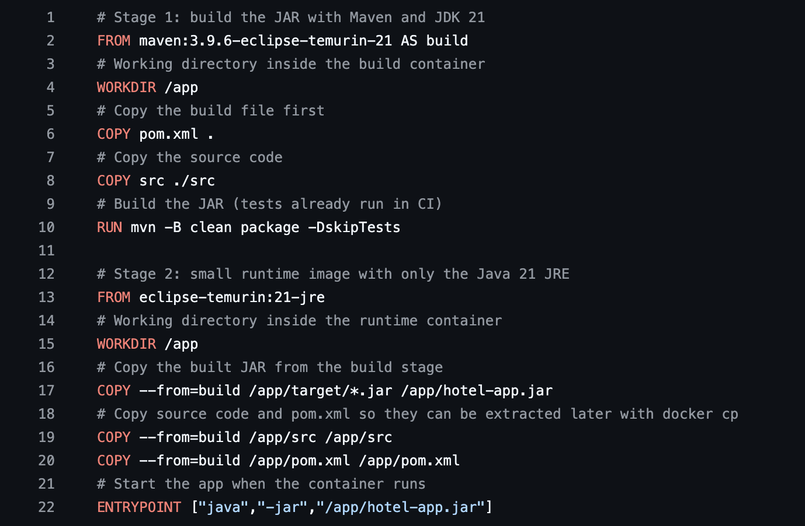

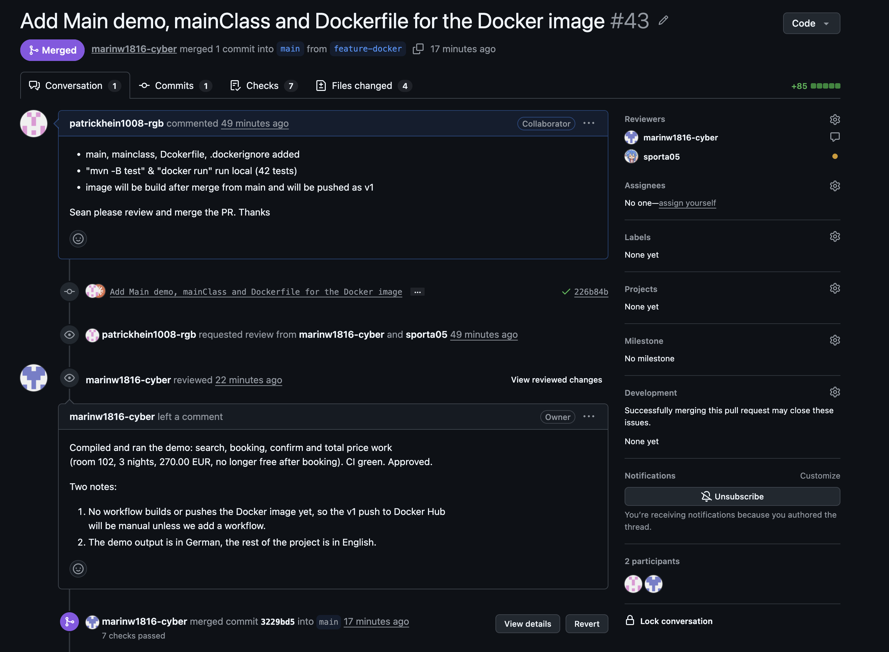

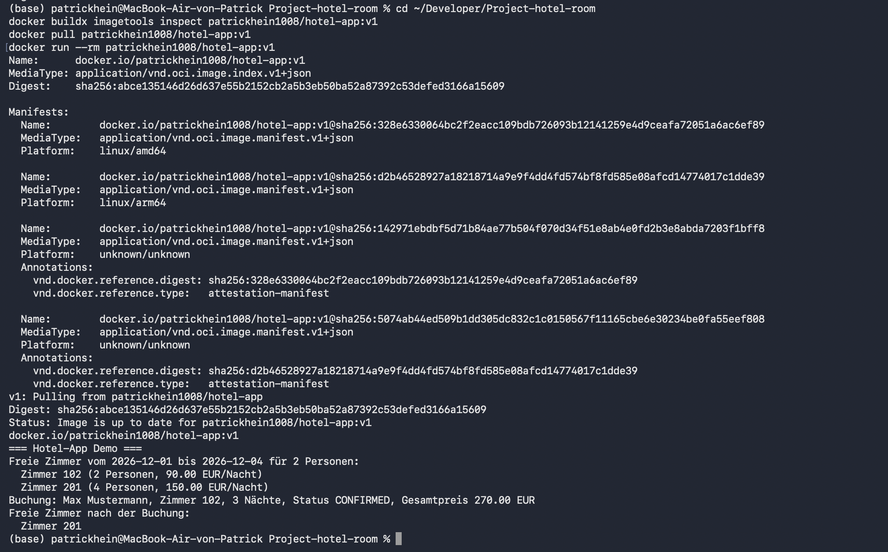

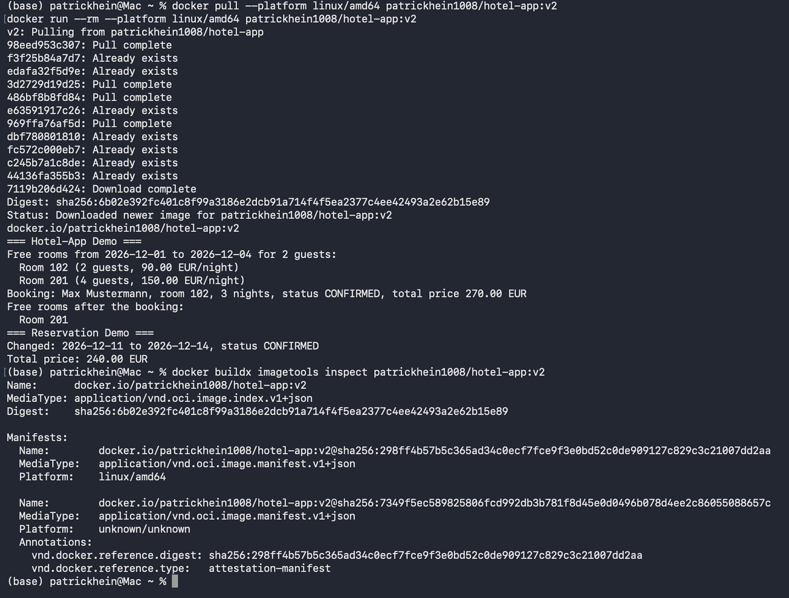

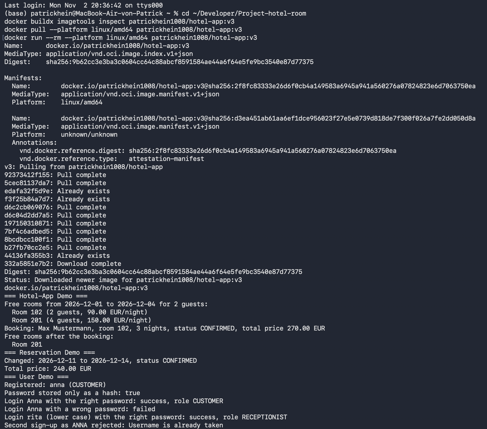

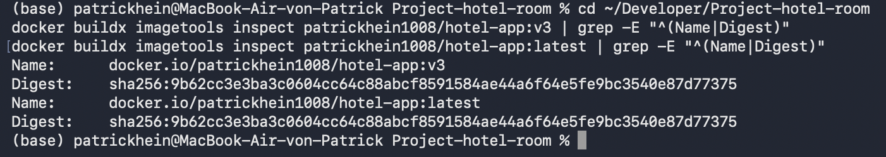

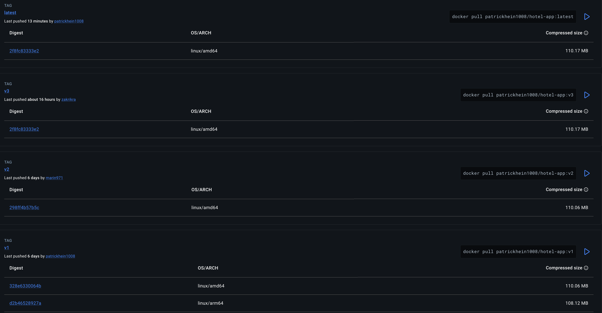

---

## Own part: Patrick
Role: I built the first image and the Docker Hub repository, did reviews and the last step (pull, check, `latest`).

- **Step 1 (PR #43, merged on 28.10.2026):** I added `hotel.app.Main`. It is a small console demo. It lists the rooms, searches free rooms from 2026-12-01 to 2026-12-04 for 2 guests and makes one booking. I also set `mainClass` in the `pom.xml`, so `java -jar` can start the app, and I wrote the `Dockerfile` and a `.dockerignore`.
- **Dockerfile:** It has two stages. The first one (`maven:3.9.6-eclipse-temurin-21`) builds the JAR. The second one (`eclipse-temurin:21-jre`) only runs it, so the final image is smaller. I also copy `src` and `pom.xml` into the final image. That way Marin and Sean can take the source code out with `docker cp`.
- **`v1`:** I built it with Buildx for `linux/amd64` and `linux/arm64` and pushed it to `patrickhein1008/hotel-app`. Its output is still German, because we translated the texts later. `v2` and `v3` were built on Windows and only exist for `linux/amd64`. On my Mac (Apple Silicon) I need `--platform linux/amd64` for them. Without it `docker pull` says "no matching manifest for linux/arm64/v8".
- **Docker Hub:** I created the repository. Marin pushed `v2` and Sean pushed `v3`, you can see this on the tags page, so both have access.
- **Reviews:** For PR #44 (Marin, step 2) I read the two changed files. A compile and run of `Main` was done with Claude on a copy of the branch. I did not run `mvn test` myself, but CI was green. My first review was only a "Comment", so the branch rule still blocked the merge. Then I submitted an "Approve" and merged. I also reviewed and merged PR #48 (README) and PR #49 (two unused images).
- **PR #47:** I translated the German error messages and demo texts to English, with help from Claude. Marin merged it. Because of this, `v2` and `v3` print English.
- **Check of `v2`:** I pulled it with `--platform linux/amd64` and ran it. The digest `sha256:6b02e392...15e89` is the same as in Marin's push output.
- **Step 4 (03.11.2026):** I pulled `v3` and ran it. All three demos show up in English: hotel demo, reservation demo and user demo. Then I set `latest` from `v3` with `docker buildx imagetools create`. Both tags have the same digest, `sha256:9b62cc3e...d77375`.
- **Claude:** I used Claude (chat and Claude Code) for code, reviews and this report. It never commits, pushes or merges. I run the builds and do the Git steps myself.

What did not go as planned:
- I merged PR #41 (the report plan) myself, although I was the author. It only changed documentation.
- Step 3 was requested for 31.10.2026, but it was merged on 02.11.2026 (PR #50). `v3` was pushed in the evening of 02.11. Docker Hub only shows "last pushed about 16 hours ago", so the time is approximate.
- `v1` prints German, `v2` and `v3` print English.

## Own part: Marin
(Text and screenshots by Marin, added to the report by Patrick.)

Role: step 0 (branch rule on main) and step 2 of the chain (pull `v1`, add the reservation demo, build and push `v2`). Reviewer and merger of Seungheon's PR #50.

- Branch rule on main (step 0, 28 October): pull request with 1 approval required, status check `Test hotel-app` required and branch up to date with main, force pushes blocked, also for admins. Later I added: approvals are dismissed when new commits are pushed, the "Update branch" button, Dependabot alerts and secret scanning with push protection. The rule worked: my own PR #44 stayed blocked until Patrick's review was submitted as "Approve" (his first review was a "Comment").

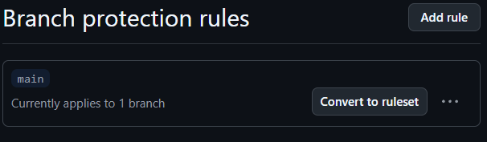

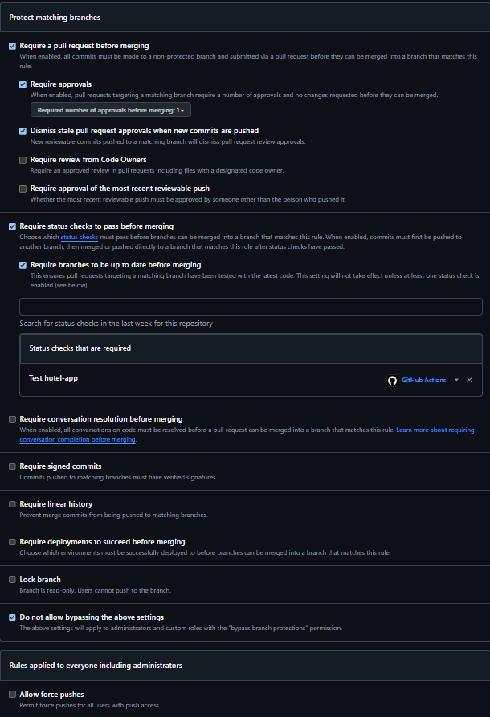

- Pull and run `v1`: Docker Desktop with WSL 2 on Windows (architecture x86_64). `docker pull patrickhein1008/hotel-app:v1` showed the index digest `sha256:abce1351…3166a15609`, the same as the one Patrick sent, and `docker run --rm` printed the demo.

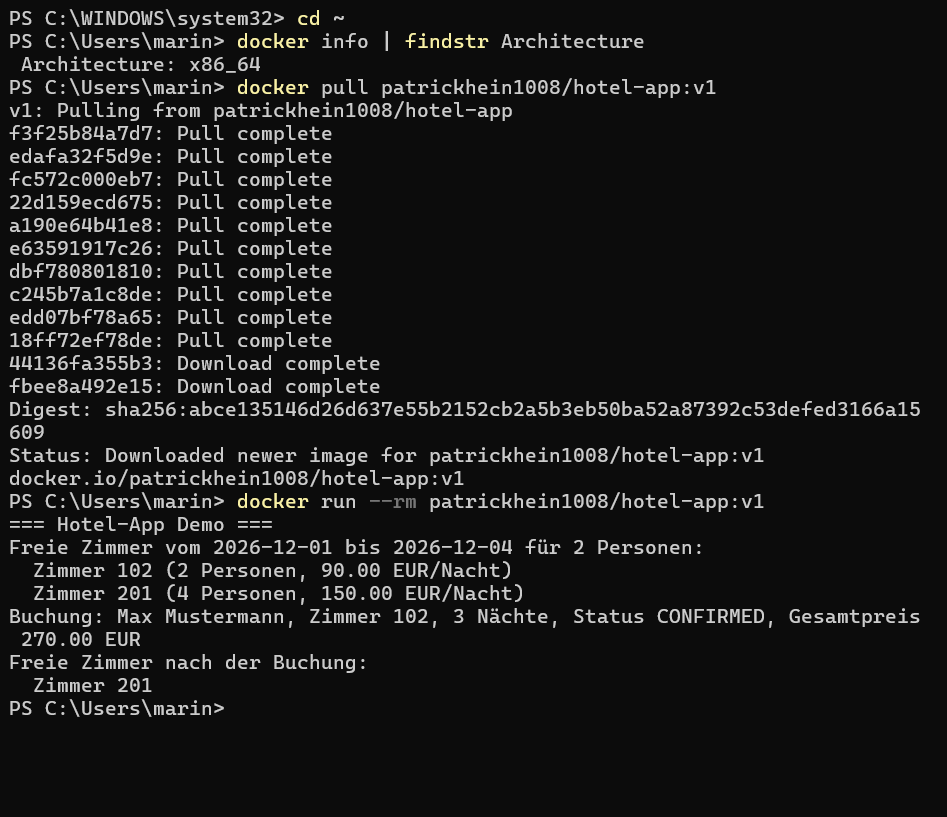

- Source out of the image: `docker create --name hotel_tmp patrickhein1008/hotel-app:v1`, `docker cp hotel_tmp:/app/src ./image_source`, `docker rm hotel_tmp`, in a folder outside of the repository. The folder had the same packages and tests as `hotel-app/src` on main.

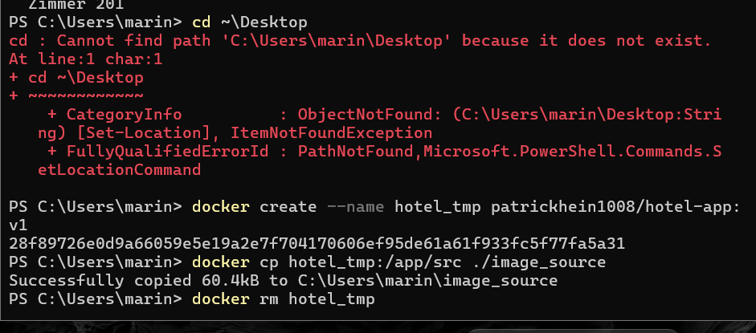

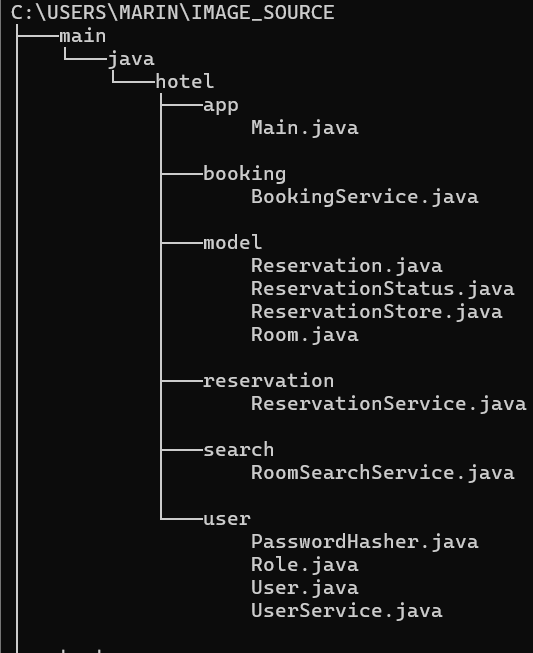

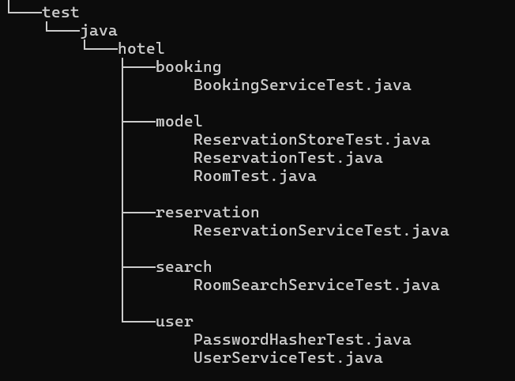

- Change: branch `feature-docker-reservation` from the latest GitHub main. New `hotel.reservation.ReservationDemo` (create a reservation, confirm it, change the dates from Dec 10→12 to Dec 11→14, print the total price: 3 nights × 80.00 = 240.00 EUR) and one line in `Main` that calls it. Sean's line in `Main` stayed untouched. Before the PR I built and ran the image locally to check the output.
- Pull request #44: CI green, reviewed by Patrick (files, compile and run of `Main`), approved and merged by him. His two cosmetic points (one space too much in front of `ReservationDemo.run();`, import not in alphabetical order) are still open in `Main`.

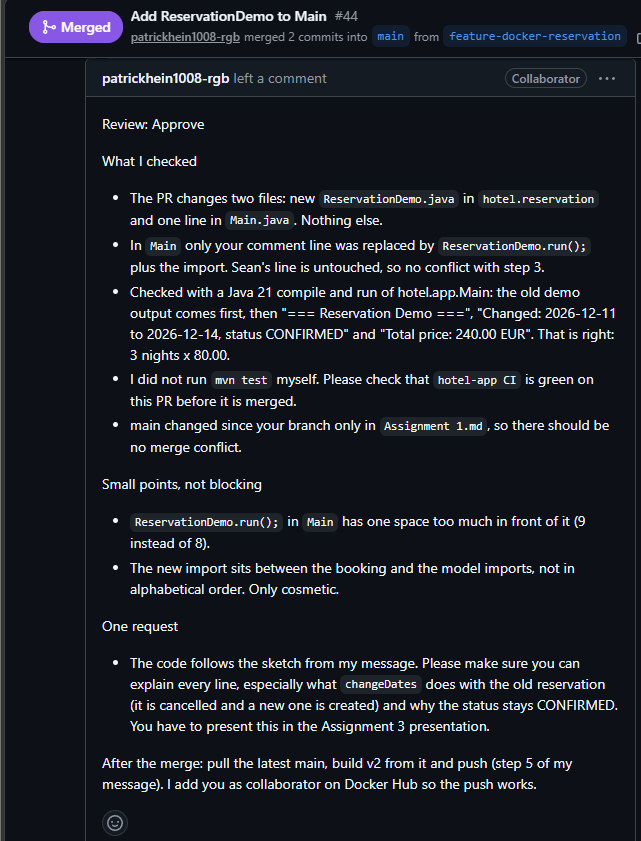

- Build and push `v2` (28 October): from the merged main `650cd83`. main had moved from `871484d` because PR #47 (English messages) was merged after #44, so `v2` already prints English text. `docker build -t marin971/hotel-app:v2 .`, `docker run --rm` showed both demos, then `docker tag … patrickhein1008/hotel-app:v2` and `docker push`. Digest: `sha256:6b02e392fc401c8f99a3186e2dcb91a714f4f5ea2377c4ee42493a2e62b15e89`. `v2` is amd64 only because I built it on my x86_64 laptop, so the README tells Apple Silicon users to add `--platform linux/amd64`.

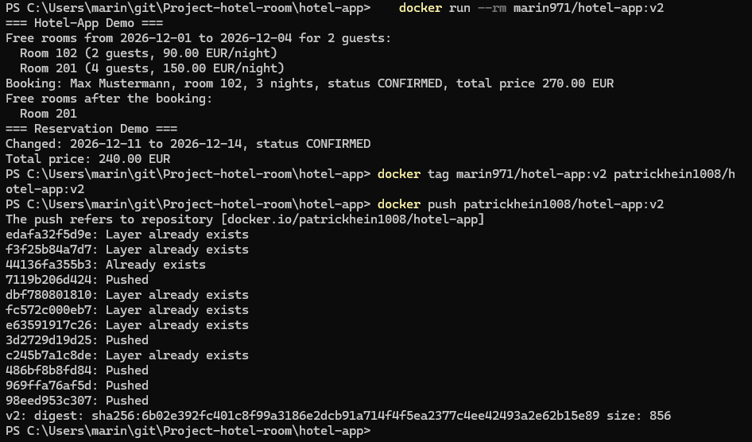

- Review of step 3: I reviewed Seungheon's PR [#50](https://github.com/marinw1816-cyber/Project-hotel-room/pull/50) (two changed files, CI green). I asked to change the text "Password stored: true", because it read as if the password was stored in plain text. After his fix ("Password stored only as a hash: true") I approved and merged the PR on 2 November. Afterwards I pulled latest and checked that all three demos run.

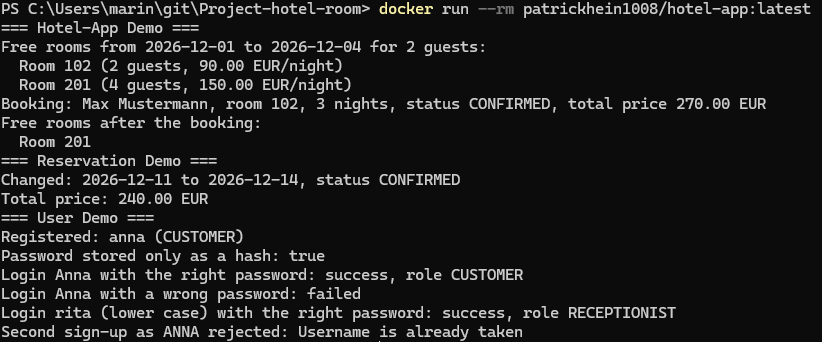
- Problems: the Docker installer needed the Windows feature "Virtual Machine Platform" (`wsl --install` as admin and a restart). "failed to connect to the docker API" meant that Docker Desktop was not running. My local clone had GitLab as `origin`, so I added a remote `github` and built from `github/main`.

## Own part: Seungheon
Role: step 3 of the chain (pull `v2`, add the user demo, build and push `v3`).

- **Pull and run `v2`:** On Windows 11 with Docker Desktop I pulled `patrickhein1008/hotel-app:v2` and ran it. It prints the hotel demo and the reservation demo. The user demo is not in `v2` yet, as planned.

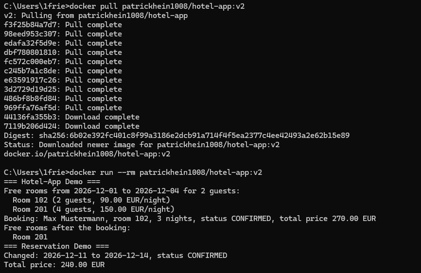

- **Change:** On the branch `feature-docker-user` I added `hotel.user.UserDemo`. It signs up a customer and a receptionist, shows that the password is stored only as a hash, logs in with a right and a wrong password, and shows that a second sign-up with the same name in other letters is rejected. It uses the `UserService` from Assignment 2. `Main` got one line that calls `UserDemo.run()`. Marin's `ReservationDemo` line stayed untouched.
- **Pull request #50:** CI was green. Marin reviewed it, asked for a clearer output text, I changed it, and he approved and merged the PR on 2 November.

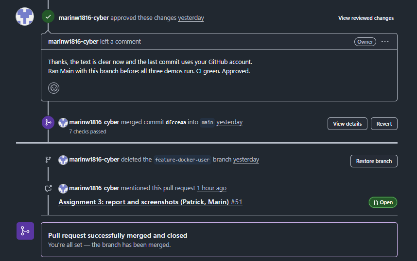

- **Build and push `v3`:** After the merge I built the image and ran it. It prints all three demos: hotel demo, reservation demo and user demo. Then I pushed it to `patrickhein1008/hotel-app:v3`. `v3` exists only for `linux/amd64`, because I built it on Windows x86_64.

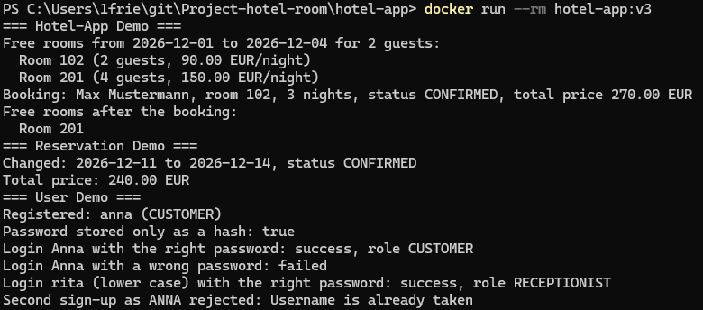

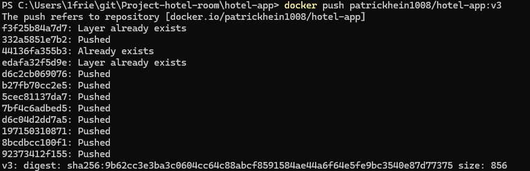
