Team: Exchange student
2601764 Seungheon, Sa
2601783 Wasier, Marin
2601760 Hein, Patrick

# Assignment 4 (Docker Compose): Report

Status: in progress. Part 1 to 4 is what we planned, part 5 and the own parts show what we actually did.

## 1. Application, Dockerfile and docker-compose.yml
- We use the same `hotel-app` as in Assignment 2 and 3 (Java 21, Maven).
- For this assignment we changed it to a Spring Boot app (version 4.1.2) with a MariaDB database and a small REST API for rooms.
- The old packages (`booking`, `model`, `reservation`, `search`, `user`) were not changed.
- New start class: `hotel.app.HotelApplication`. The console demo `Main` from Assignment 3 is still in the code but doesn't start anymore.
- The room API is in the package `hotel.room`, the data is in the table `room`.
- Dockerfile: `hotel-app/Dockerfile`, same multi-stage build as in Assignment 3, we only added `EXPOSE 8080`.
- `docker-compose.yml` is in the root of the repo.

## 2. Who does what
| Step | Person | Task | Branch | Reviewer (merges) |
|---|---|---|---|---|
| 1 | Patrick | Spring Boot setup, `docker-compose.yml` with `mariadb` and `hotel-app`, `.env.example` | `feature-compose` | Seungheon |
| 2 | Marin | REST API for rooms under `/api/rooms`, tests with H2 | `feature-room-api` | Patrick |
| 3 | Seungheon | Test everything together on Windows (curl, data in MariaDB, volume) | `test-compose` | Marin |
| 4 | Patrick | Report | `report-compose` | Marin |

Plan vs. reality:
- Step 1: PR #53, Seungheon approved and merged it on 07.11.
- Step 2: PR #54, I approved and merged it on 09.11.
- Step 3: [FILL IN]
- Step 4: [FILL IN]

Every step started only after the PR before was merged.

### Room API
Before step 2 we agreed on this, so Marin and Seungheon could work with the same endpoints:

| Method | Path | OK | Errors |
|---|---|---|---|
| GET | `/api/rooms` | 200 | |
| GET | `/api/rooms/{roomNumber}` | 200 | 404 |
| POST | `/api/rooms` | 201 + `Location` | 400, 409 |
| PUT | `/api/rooms/{roomNumber}` | 200 | 400, 404 |
| DELETE | `/api/rooms/{roomNumber}` | 204 | 404 |

- Body: `{"roomNumber": 101, "capacity": 2, "pricePerNight": 80.00}`
- `roomNumber` is the ID of the room. The admin sets it, the database doesn't generate it.
- 400 = wrong values (room number or capacity 0 or less, negative price), 404 = room doesn't exist, 409 = room number is already taken.
- PUT never changes the room number, it always comes from the URL.

## 3. Our docker-compose.yml
- `name: hotel-compose` so the containers and the network have the same names on everyone's laptop.
- `mariadb`: image `mariadb:11.4`. The data is saved in the volume `hotel-db-data`, so it is still there after `docker compose down`. It has no port to the outside, only the app can reach it over the network `hotel-net`.
- Health check for the database (`healthcheck.sh`, every 10 s).
- `hotel-app`: built from `./hotel-app`, port 8080. With `depends_on` and `condition: service_healthy` it waits until the database is really ready and not just started.
- The app connects to `jdbc:mariadb://mariadb:3306/hoteldb`. `mariadb` here is just the service name, Docker finds the container by that name.
- Passwords: only in a local `.env` file, which is in `.gitignore`. In the repo there is only `.env.example` with `change-me`.

## 4. How to start it
```
cp .env.example .env          (then change the two passwords)
docker compose up -d --build
docker compose ps
docker compose logs hotel-app
docker compose down           (containers gone, data stays)
docker compose down -v        (data also gone)
```
On Windows it's `Copy-Item .env.example .env` and `curl.exe` instead of `curl`.

## 5. Testing (screenshots)
### Step 1 (Patrick, Mac, 04.11.)
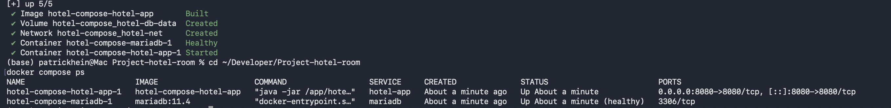
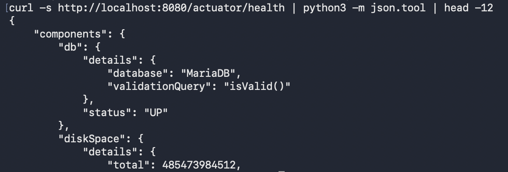
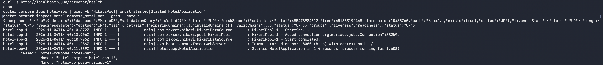
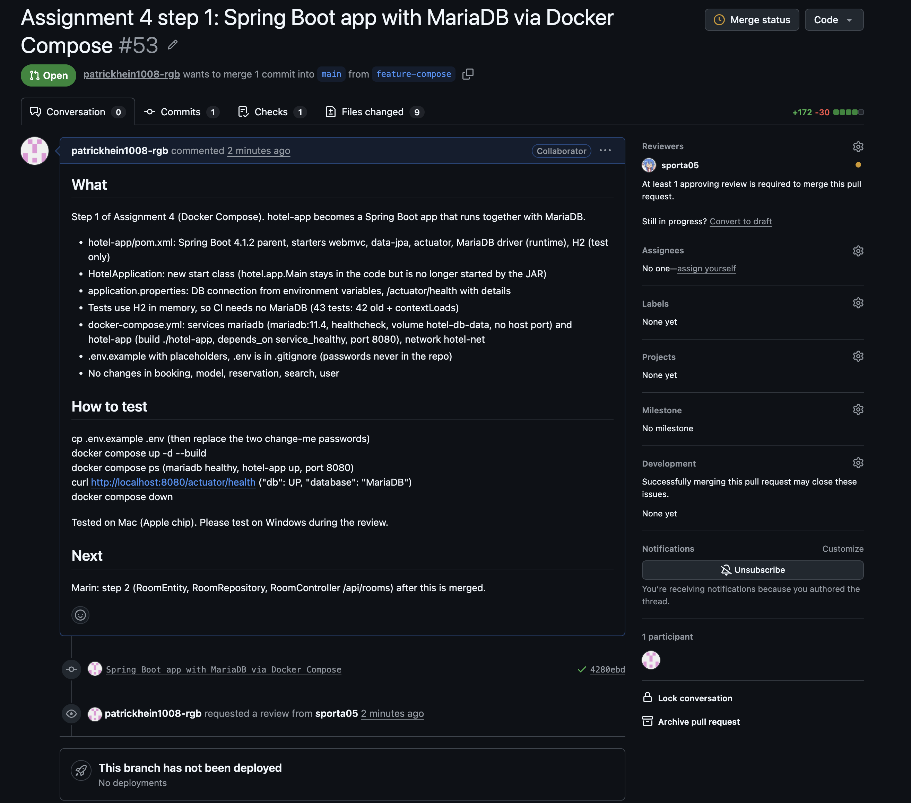
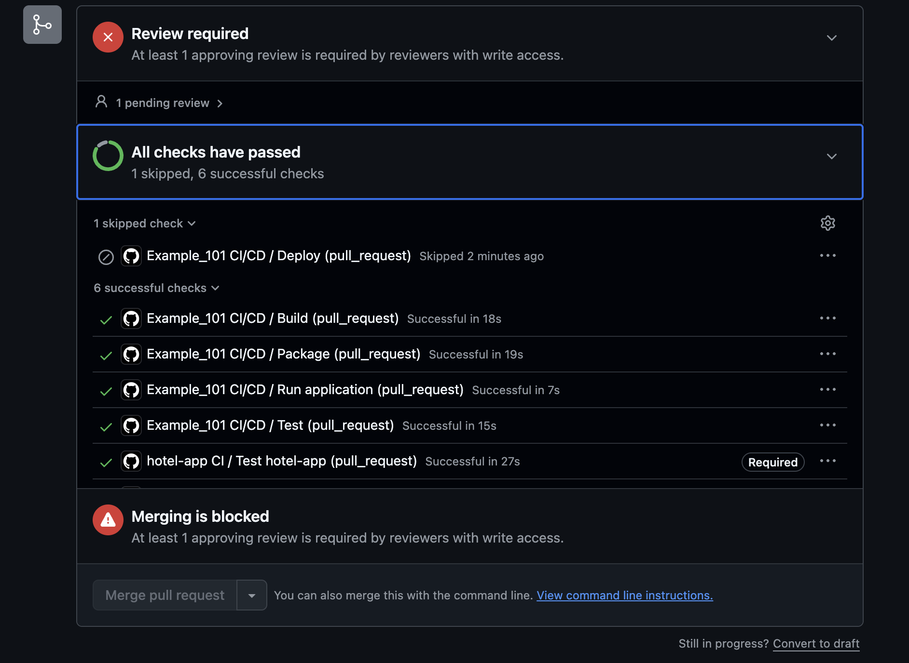
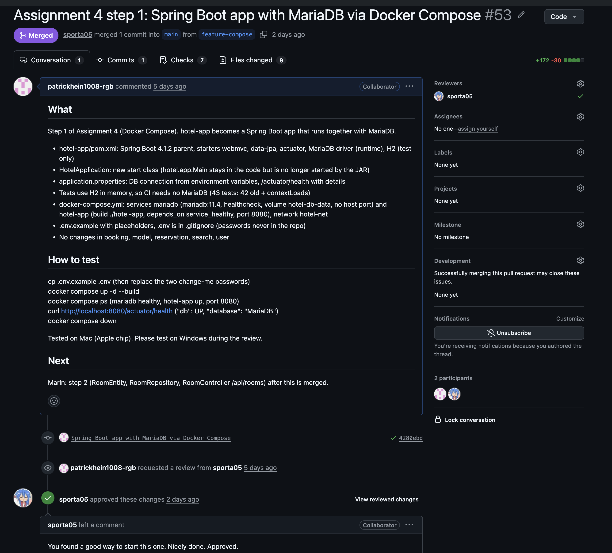

### Step 2 (Marin, Windows)
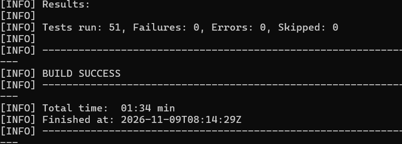
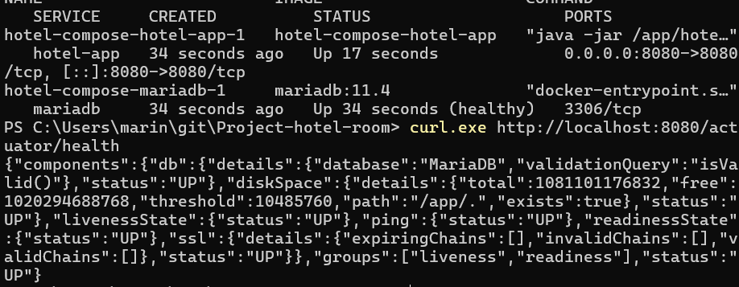
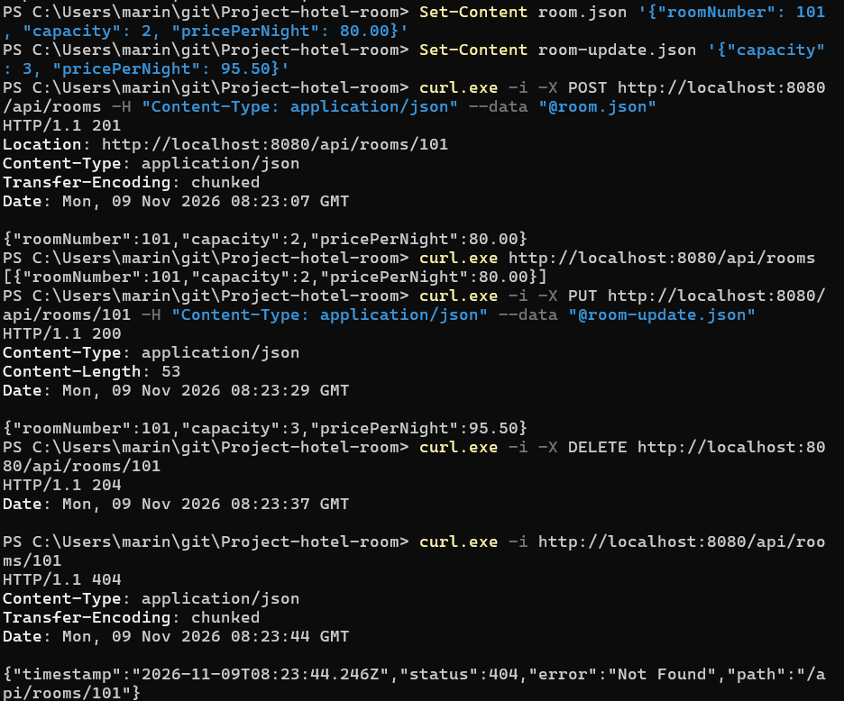

My review of step 2 (Patrick, Mac, 09.11.):
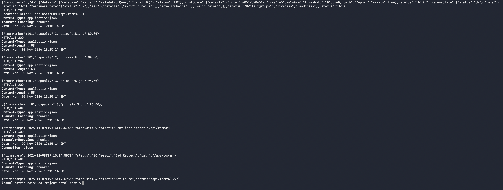
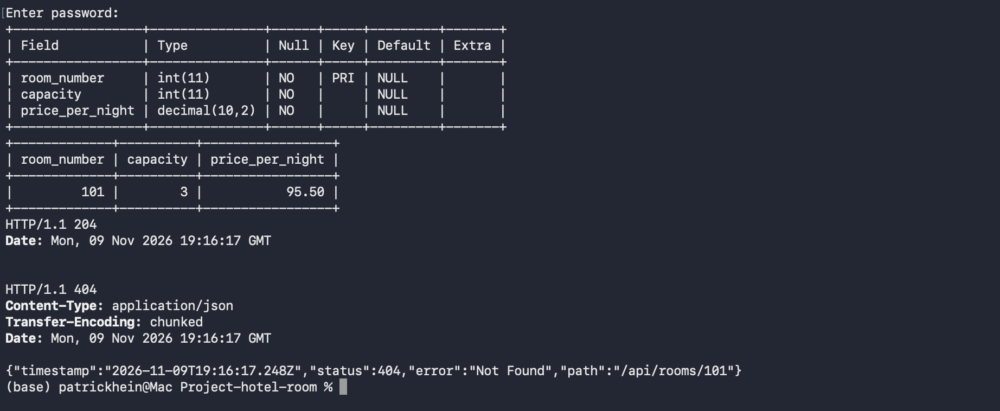
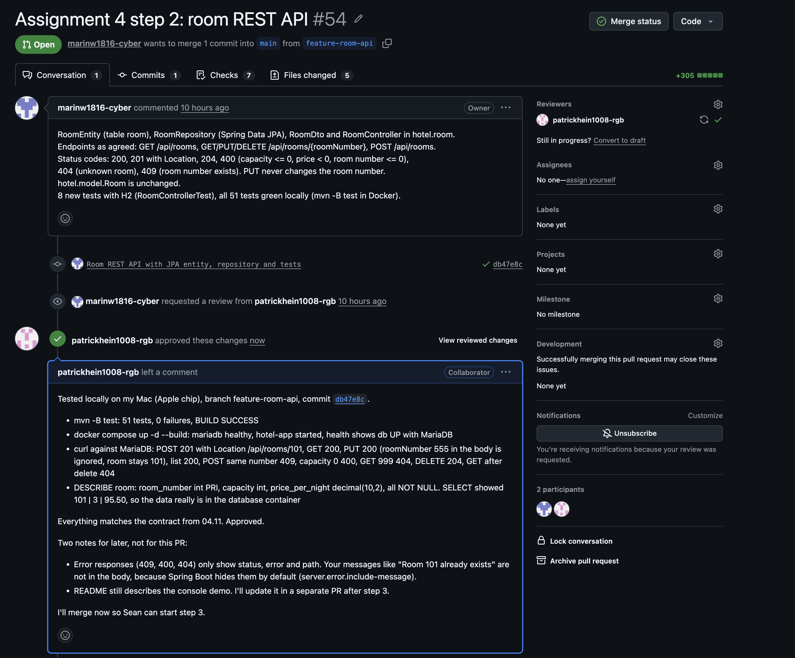

### Step 3 (Seungheon, Windows)
[FILL IN]

## 6. Rules
- Own branch from `main`, PR with a description, CI (`Test hotel-app`) has to be green.
- Review with "Approve", a comment is not enough. The author doesn't merge his own PR.
- No `--force`, no passwords or `.env` in Git.

## Own part: Patrick
Role: step 1, review of Marin's step 2, report.

- **Step 1 (PR #53):** I changed `hotel-app` to Spring Boot and wrote the `docker-compose.yml` with the two services `mariadb` and `hotel-app`. The app gets the database URL, user and password from environment variables, Compose takes them from `.env`. So there is no password in the code.
- I didn't give the database a port to my Mac on purpose. It only has to be reachable for the app.
- **Tests:** The CI on GitHub has no MariaDB, so the tests use H2 in memory. I added one test that starts the whole Spring app. 43 tests, all green, also in CI.
- **On my Mac:** `docker compose up -d --build` built the image and started both containers. MariaDB 11.4 also has an image for the Apple chip, and the app image is built locally, so this time I didn't have the `--platform` problem from Assignment 3.
- To check that the two containers really talk to each other I used `/actuator/health` (shows `db` UP with MariaDB) and the app log, where you can see the connection to MariaDB.
- Seungheon approved and merged PR #53 on 07.11.
- **Review of step 2 (PR #54):** I took Marin's branch and ran `mvn -B test` myself, 51 tests green. Then I started the stack with his code and tried every endpoint with curl. All status codes were like we agreed. I also sent a PUT with room number 555 in the body and the room stayed 101, which is what we wanted. With `DESCRIBE` and `SELECT` I checked in MariaDB that the room is really saved there. After that I approved and merged.
- Two small things I wrote in the review for later: the error answers don't show Marin's message (Spring Boot hides it by default), and the README still talks about the old console demo.
- Small pitfall: right after `docker compose up -d` the app needs a second or two. My first curl was too early and showed nothing.

What did not go as planned:
- [FILL IN or delete]

## Own part: Marin
(Text by Marin, added by Patrick. His screenshots are in part 5, step 2.)

Role: step 2 (room REST API in `hotel.room`), reviewer of step 3 and of the report.

- **What PR #54 adds:** four classes in the new package `hotel.room`. `RoomEntity` is the room as it is stored in the table `room` (`roomNumber` is the `@Id`, set by the admin, `capacity`, `pricePerNight` as `decimal(10,2)`). `RoomRepository` is a Spring Data JPA interface, so there is no SQL in our code. `RoomDto` is the JSON body. `RoomController` has the five endpoints from Patrick's contract of 04.11. `hotel.model.Room` is unchanged.
- **Rules:** the same as in `hotel.model.Room`: capacity > 0, price >= 0, room number > 0 → otherwise 400. Unknown room → 404, POST with an existing number → 409, POST returns 201 with a `Location` header, DELETE returns 204. In a PUT the room number always comes from the URL, a number in the body is ignored.
- **Tests:** 8 new tests in `RoomControllerTest`, one per case of the contract (201 + Location, 409, 400, list, 200/404, PUT does not change the room number, PUT 404/400, DELETE 204 then 404). They use H2, so no MariaDB is needed in CI. I ran `mvn -B test` in a Maven Docker container on Windows: 51 tests, 0 failures.
- **Test with Docker Compose on Windows:** `.env` from `.env.example` with my own passwords, then `docker compose up -d --build`. `docker compose ps` showed both containers running and `mariadb` healthy, and `/actuator/health` showed `db` UP with MariaDB.
- **CRUD with curl against MariaDB:** POST room 101 → 201 with `Location: http://localhost:8080/api/rooms/101`, GET list → room 101, PUT capacity 3 and price 95.50 → 200, DELETE → 204, GET 101 → 404. To avoid quoting problems with JSON in PowerShell I put the bodies in small files and used `curl.exe --data "@room.json"`. Then `docker compose down` (without `-v`).
- PR #54 was reviewed, approved and merged by Patrick on 09.11.

What did not go as planned:
- My first test run failed: `@SpringBootTest` could not find the Spring configuration, because the test is in `hotel.room` and `HotelApplication` is in `hotel.app` (Spring only searches the packages above the test). Fixed with `@SpringBootTest(classes = HotelApplication.class)`.
- The error answers (400, 404, 409) only show status, error and path, not the message like "Room 101 already exists", because Spring Boot hides it by default (Patrick's note in the review). Not changed yet.

## Own part: Seungheon
(Text and screenshots by Seungheon, added by Patrick.)
[FILL IN]
