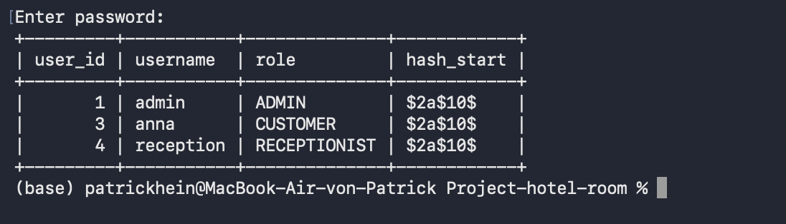
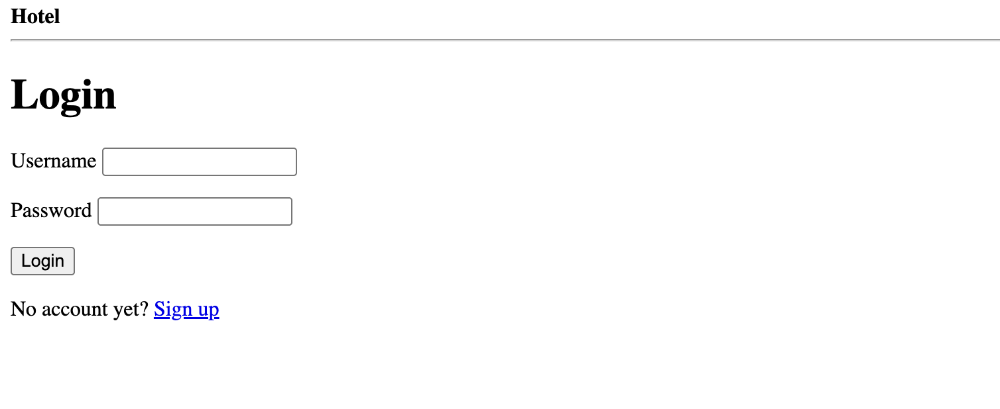
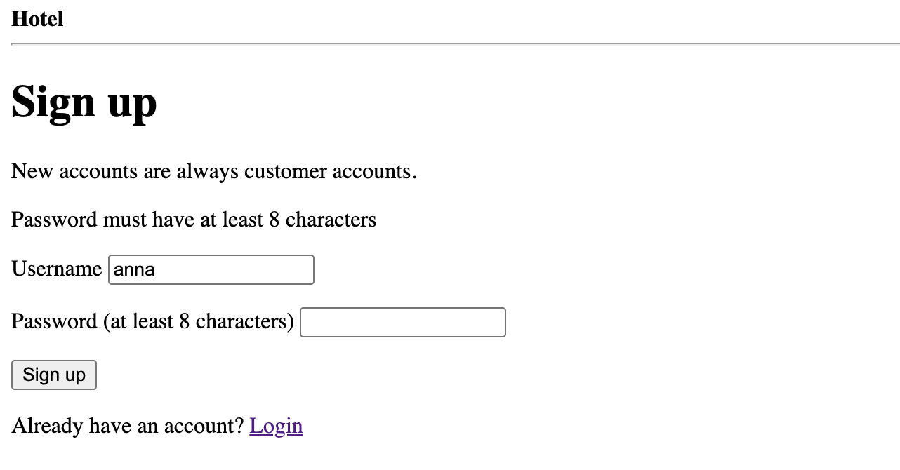
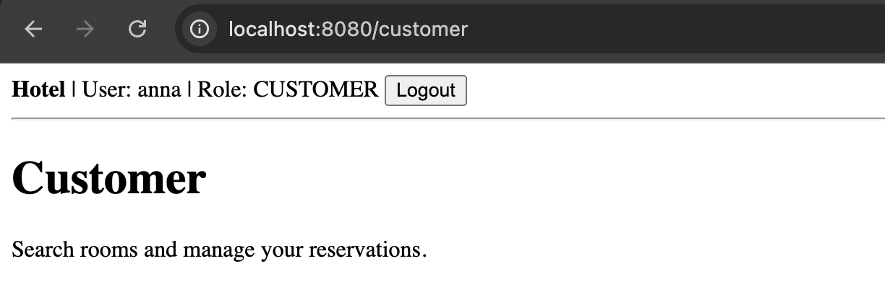
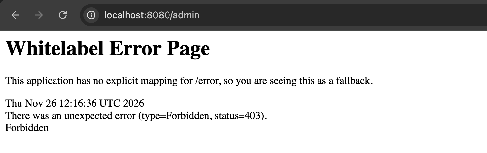
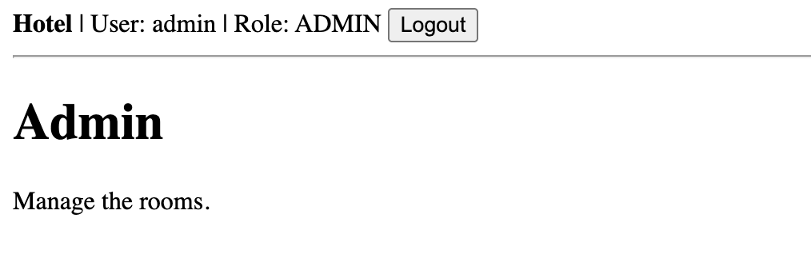
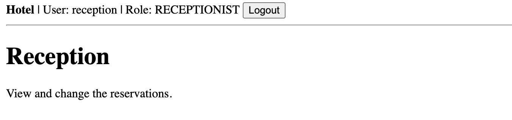
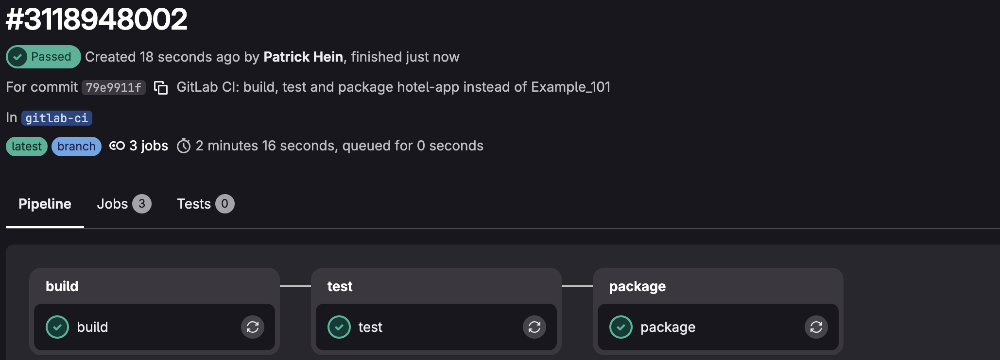
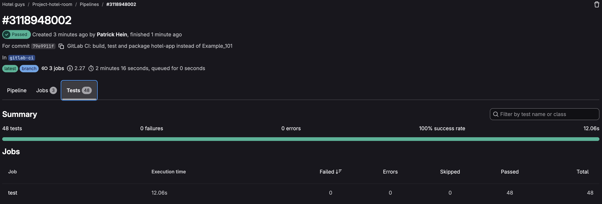

# Hotel Room Reservation: User Manual

Team: Exchange student

| Student number | Name |
|---|---|
| 2601764 | Seungheon Sa |
| 2601783 | Marin Wasier |
| 2601760 | Patrick Hein |

- GitLab repository: https://gitlab.com/hotel-guys/Project-hotel-room
- Docker image: `marin971/hotel-app:1.0` [FILL IN after push, platforms amd64 and arm64]

## 1. Final Project Plan

### 1.1 Decisions
- Web pages with Thymeleaf, served by the same Spring Boot application (one container)
- Sign-in with Spring Security form login, passwords stored as BCrypt hash
- Three roles: `ADMIN`, `CUSTOMER`, `RECEPTIONIST`
- Sign-up always creates a `CUSTOMER`. The admin and the receptionist account are created at the first start from environment variables in `.env`, so nobody can make himself admin
- Data in MariaDB 11.4, started with Docker Compose
- Development on GitHub (branch rule, GitHub Actions, Jenkins), `main` mirrored to GitLab at fixed points (GitLab CI runs there)

### 1.2 Team Split
| Person | Branch | Part | Reviewer |
|---|---|---|---|
| Patrick | `feature-security` | Sign-up, sign-in, roles, `app_user` table, start pages | Marin |
| Patrick | `gitlab-ci` | GitLab pipeline for `hotel-app` | Marin |
| Patrick | `user-manual` | This manual | Marin |
| Marin | `feature-reservation-db` | Reservations in the database, customer pages | Sean |
| Sean | `feature-admin-rooms` | Admin pages for rooms | Patrick |
| Sean | `feature-reception` | Reception pages | Patrick |
| Marin | none | Multi-arch image `marin971/hotel-app:1.0` | Patrick |

### 1.3 Timeline
| Date | Milestone | Status |
|---|---|---|
| Thu 26.11. | Plan, sign-in and roles merged (PR #66), GitLab pipeline green | done |
| Sat 28.11. | Admin rooms PR | [FILL IN] |
| Sun 29.11. | Reservation DB and customer pages PR | [FILL IN] |
| Mon 30.11. | Reception PR | [FILL IN] |
| Tue 01.12., 18:00 | Feature freeze, only bug fixes after this | [FILL IN] |
| Wed 02.12. | Cross test with fresh database, image 1.0, manual done | [FILL IN] |
| Thu 03.12., 18:00 | Submission on Moodle | [FILL IN] |

### 1.4 Rules
- Own branch from `main`, pull request with description, CI green, review before merge, no force push
- No passwords or tokens in the repo, only `.env.example`

## 2. Project Specification Report

### 2.1 General Idea
A web application for a hotel. Customers book rooms online, the receptionist manages the bookings and the administrator manages the rooms. Each role sees only its own pages.

### 2.2 Purpose
- Replace bookings by phone or on paper with one system
- No double booking of a room
- Every reservation and every room is stored in a database, so the data stays after a restart

### 2.3 Users and Roles
| Role | How the account is created | Start page |
|---|---|---|
| `CUSTOMER` | Sign-up page `/signup` | `/customer` |
| `RECEPTIONIST` | Start account from `.env` (`APP_RECEPTION_*`) | `/reception` |
| `ADMIN` | Start account from `.env` (`APP_ADMIN_*`) | `/admin` |

After sign-in, `/` sends each user to the start page of his role. A user who opens a page of another role gets `403 Forbidden`.

### 2.4 Functional Requirements
| ID | Requirement | Role | Status |
|---|---|---|---|
| FR-01 | A visitor creates an account with username and password on `/signup`. The new account always has the role `CUSTOMER` | Customer | done (#66) |
| FR-02 | A user signs in on `/login` and signs out with `/logout` | All | done (#66) |
| FR-03 | Pages under `/admin/**` only for `ADMIN`, `/reception/**` only for `RECEPTIONIST`, `/customer/**` only for `CUSTOMER` | All | done (#66) |
| FR-04 | The admin adds a room with `roomNumber`, `capacity` and `pricePerNight` | Admin | [FILL IN] |
| FR-05 | The admin views the list of all rooms | Admin | [FILL IN] |
| FR-06 | The admin updates `capacity` and `pricePerNight` of a room | Admin | [FILL IN] |
| FR-07 | The admin deletes a room | Admin | [FILL IN] |
| FR-08 | The customer searches free rooms by check-in date, check-out date and number of guests | Customer | [FILL IN] |
| FR-09 | The customer reserves a free room for a check-in and check-out date | Customer | [FILL IN] |
| FR-10 | The customer sees a list of his own reservations | Customer | [FILL IN] |
| FR-11 | The customer cancels his own reservation or changes its dates | Customer | [FILL IN] |
| FR-12 | The receptionist sees all reservations of all customers | Receptionist | [FILL IN] |
| FR-13 | The receptionist changes the dates and the status of a reservation | Receptionist | [FILL IN] |
| FR-14 | A reservation is blocked if check-out is not after check-in or if the room is already booked in this period | System | [FILL IN] |

### 2.5 Non-Functional Requirements
| ID | Requirement | Status |
|---|---|---|
| NFR-01 | Passwords are stored only as BCrypt hash in `app_user.passwordHash` | done (#66) |
| NFR-02 | All data in MariaDB, the volume `hotel-db-data` keeps it after `docker compose down` | done |
| NFR-03 | The database has no open port, only `hotel-app` reaches it inside `hotel-net` | done |
| NFR-04 | Every push runs the tests in GitHub Actions and GitLab CI, every PR needs a review | done |
| NFR-05 | The application starts with one command: `docker compose up` | done |

### 2.6 Data Model
| Table | Primary key | Fields | Relation |
|---|---|---|---|
| `room` | `roomNumber` | `capacity`, `pricePerNight` | |
| `app_user` | `userId` (generated) | `username` (unique), `passwordHash`, `role` | |
| `reservation` | `reservationId` [FILL IN] | `roomNumber`, [FILL IN `userId` or `customerUsername`], `checkIn`, `checkOut`, `status` | many reservations to one room, many reservations to one customer |

Reservation status: `PENDING`, [FILL IN values from `ReservationStatus`].

### 2.7 Architecture
- Browser sends HTTP requests to the Spring Boot application (port 8080)
- Spring Security checks the sign-in and the role before a controller runs
- Controllers render Thymeleaf pages, repositories (Spring Data JPA) read and write MariaDB
- Docker Compose starts two containers, `mariadb` and `hotel-app`, in the network `hotel-net`

[FILL IN: diagram Images/fp_architecture.png]

## 3. Installation and Start
[FILL IN: clone, copy `.env.example` to `.env`, `docker compose up --build`, open http://localhost:8080. Variant with the Docker Hub image `marin971/hotel-app:1.0`. Pitfall old volume: `docker compose down -v`.]

## 4. Usage per Role
### 4.1 Sign-up and Sign-in

### 4.2 Customer
[FILL IN Marin]
### 4.3 Administrator
[FILL IN Sean]
### 4.4 Receptionist
[FILL IN Sean]

## 5. CI/CD and Docker
- GitHub Actions: `hotel-app CI` runs `mvn -B test` on every push and PR
- GitLab CI: stages build, test (JUnit report), package (JAR as artifact), image `maven:3.9.6-eclipse-temurin-21`

- Jenkins: [FILL IN from Assignment 5]
- Docker Hub: [FILL IN]

## 6. Limits
- Not built from the Assignment 1 requirements: online payment, housekeeping list, monitoring, confirmation email, password reset
- [FILL IN after cross test]
